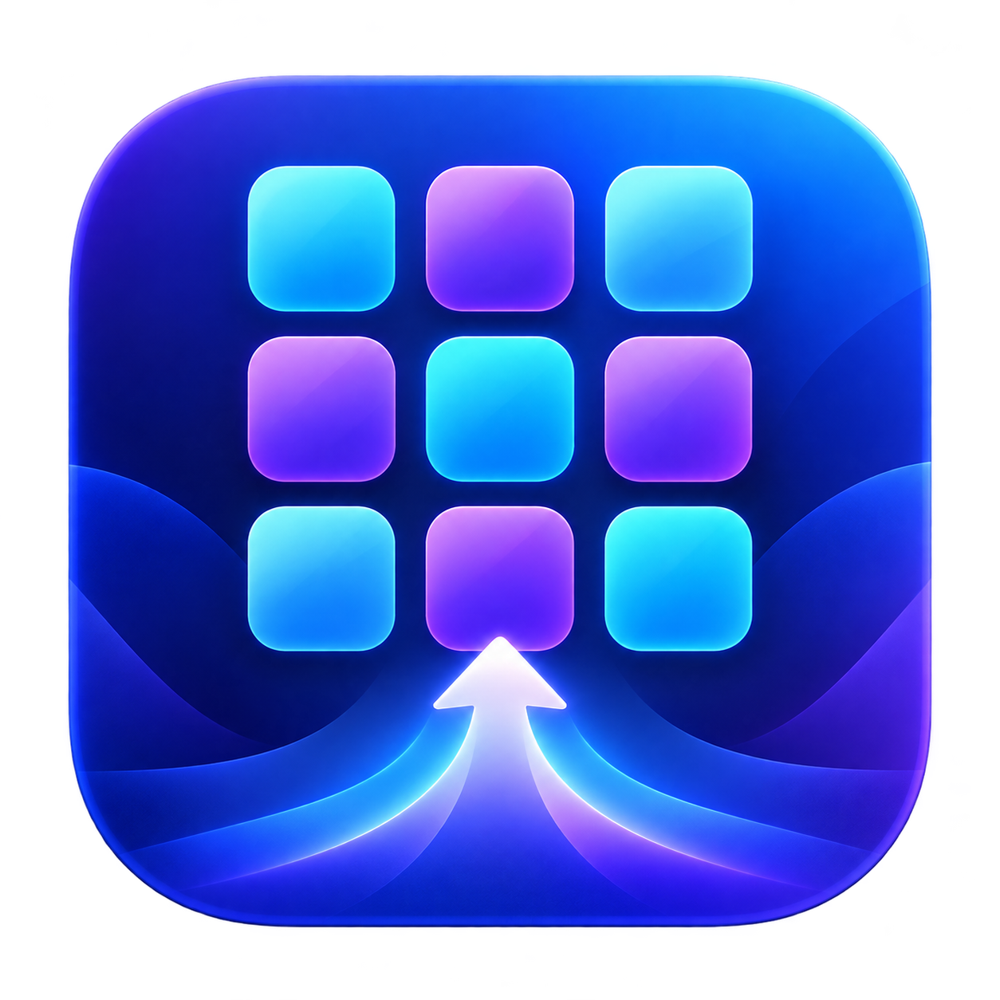
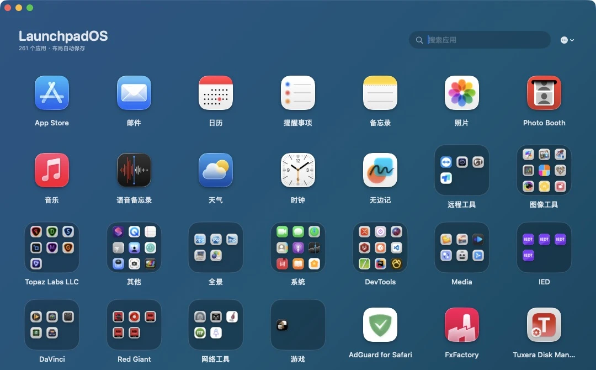
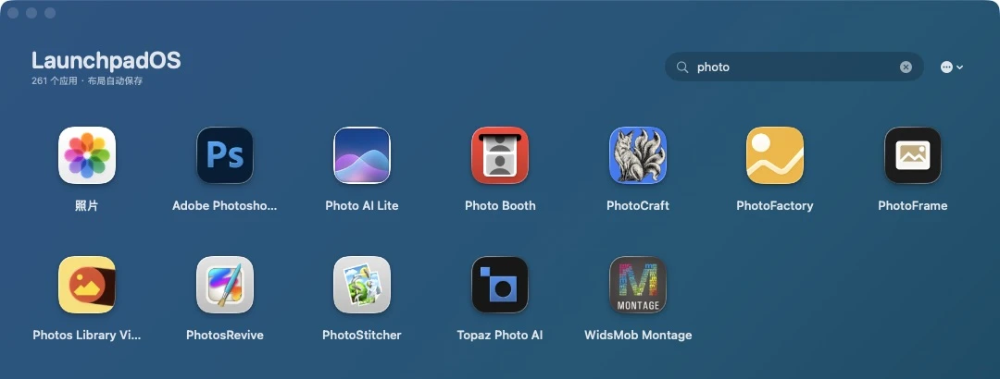
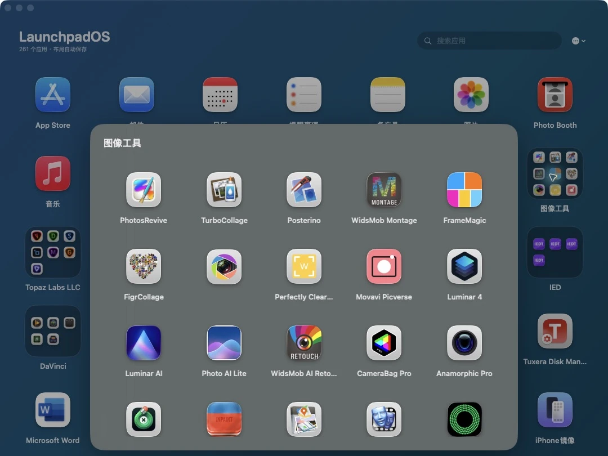
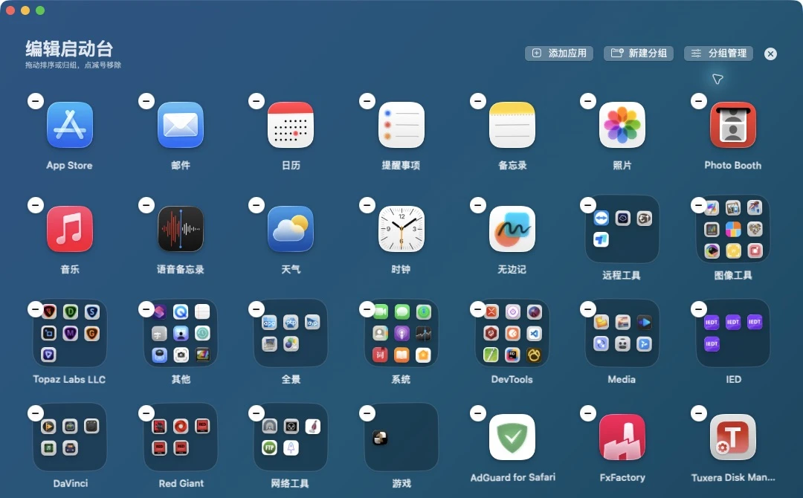
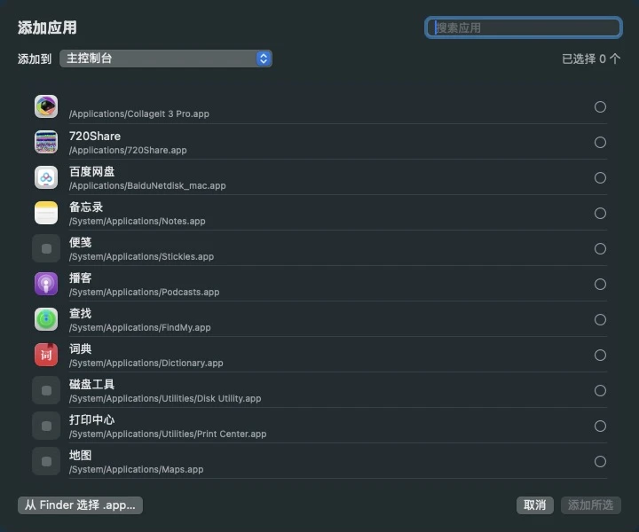
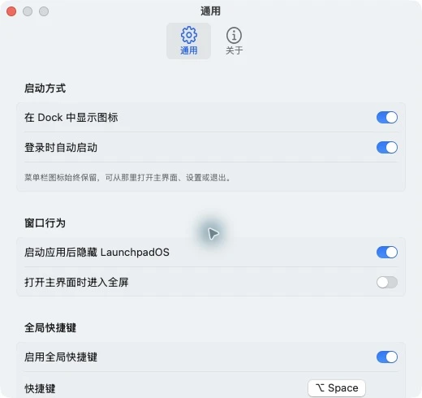

<p align="center"></p>
<h1 align="center">LaunchpadOS</h1>
<p align="center">A familiar app grid, folders and keyboard launcher for your Mac.</p>
<p align="center"><a href="README.md">简体中文</a> · English · <a href="https://github.com/JackerKun/LaunchpadOS/releases">Downloads</a> · <a href="#interface-tour">Interface tour</a> · <a href="#getting-started">Getting started</a> · <a href="docs/BUILDING.md">Build and release</a></p>



LaunchpadOS is an independent native macOS app launcher built with SwiftUI and AppKit. Arrange applications in your own grid, group them into folders, search by name or bundle identifier, and toggle the window with a global shortcut. It stores its own layout without modifying Dock or the system Launchpad database.

Screenshots show the installed **0.4.7, build 13** application with actual local apps. They are cropped to relevant UI, not generated mockups. The app count reflects this machine, not a performance benchmark. See [screenshot provenance](docs/screenshots/README.md).

## Downloads

Requires **macOS 14 or newer**. Choose a package from [GitHub Releases](https://github.com/JackerKun/LaunchpadOS/releases):

| Mac | Architecture label |
| --- | --- |
| Apple Silicon (M series) | `arm64` |
| Intel | `x86_64` |
| One app for both | `universal` |

Open the DMG and drag LaunchpadOS to Applications, or extract the `.app.zip`. Each release includes `SHA256SUMS.txt`. Packages are ad-hoc signed, without Developer ID notarization; macOS may display a developer-verification warning. Checksums verify file consistency, not publisher identity. Windows and Linux are not supported.

## Interface tour

### Search

Search by application name or bundle ID, including apps inside folders. Return focuses the first result; navigate with arrow keys or Tab, then press Return to open it.



### Folders

Open a folder inside the main window. Rename it inline, arrange its contents, or move apps back to the grid.



### Drag editing

Long-press an icon or choose Edit from the menu. Drag to reorder, drag one app onto another to create a folder, or drop it onto an existing folder. Removing an icon only removes it from this layout; it does not uninstall the app. Deleting a folder returns its apps to the main grid.



### Add applications

Select multiple scanned apps, choose the main grid or a destination folder, or use Finder to select an `.app` elsewhere. Original app bundles are not moved.



### Settings

Configure the Dock icon, login launch, hide-after-launch behavior, fullscreen opening and the global shortcut. Settings scroll; the screenshot shows this machine's choices, not default values.

<p align="center"></p>

## Getting started

- Default global shortcut: **Option + Space**. Toggles the window; opens on the display containing the pointer.
- **Esc** closes a folder, exits editing or hides the window, depending on context.
- **Command + Shift + R** rescans applications; **Command + comma** opens settings.
- Use arrows, Tab / Shift + Tab and Return to navigate the grid.
- Change the global shortcut in Settings. A conflicting combination is rejected while the previous valid shortcut is retained.
- The menu bar icon provides access even when the Dock icon is hidden.

Scanning covers `/Applications`, `/System/Applications` and `~/Applications`, including nested application folders. Apps elsewhere can be added manually.

## Data and legacy import

Layout and catalog cache are stored in `~/Library/Application Support/LaunchpadOS/layout.json` and `catalog.json`. Quit the app before backing up layout data. Preferences are stored separately in macOS app preferences.

Legacy import reads the **Launchpal-exported JSON** at `~/Library/Application Support/Launchpal/launchpad_data.json`. It is not a general recovery tool for system Launchpad databases. Re-import replaces the current layout: back it up first. Layout writes are atomic. Removing LaunchpadOS does not uninstall the apps it displays.

## Build and release

Requires Swift 6 and compatible Apple Command Line Tools / Xcode:

```bash
zsh scripts/build-app.sh arm64
zsh scripts/build-app.sh x86_64
zsh scripts/build-app.sh universal
```

The script discovers the active SDK (or honors `SDKROOT`), builds and verifies architecture slices, ad-hoc signs the app and creates versioned DMG / app ZIP files in `dist/`. Universal builds combine separately compiled slices using `lipo`.

The GitHub workflow builds all three variants when a stable `vX.Y.Z` tag matching `Resources/Info.plist` is pushed. It publishes all six installers with checksums after all builds pass. Manual branch runs produce Actions artifacts only. See [release instructions](docs/BUILDING.md).

Current version: **0.4.7 · Build 13**. LaunchpadOS is an independent application, not an Apple product or a system patch.
