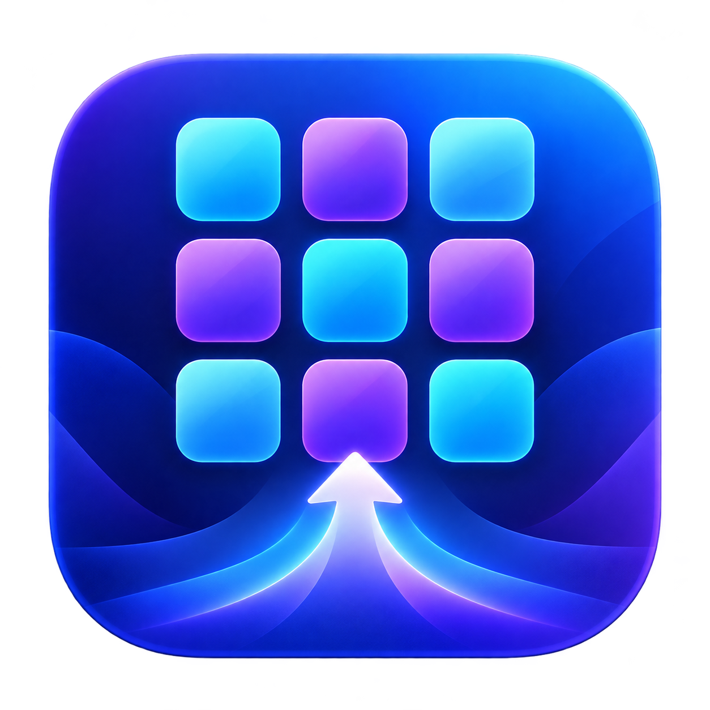
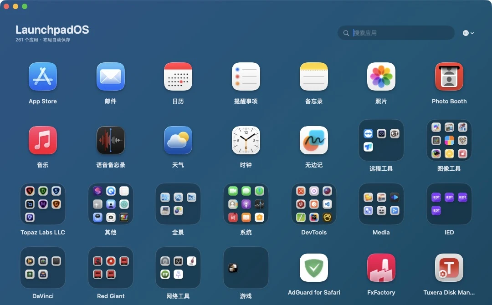
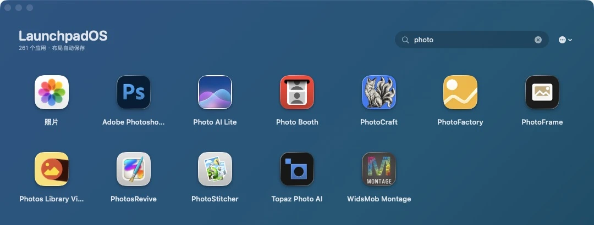
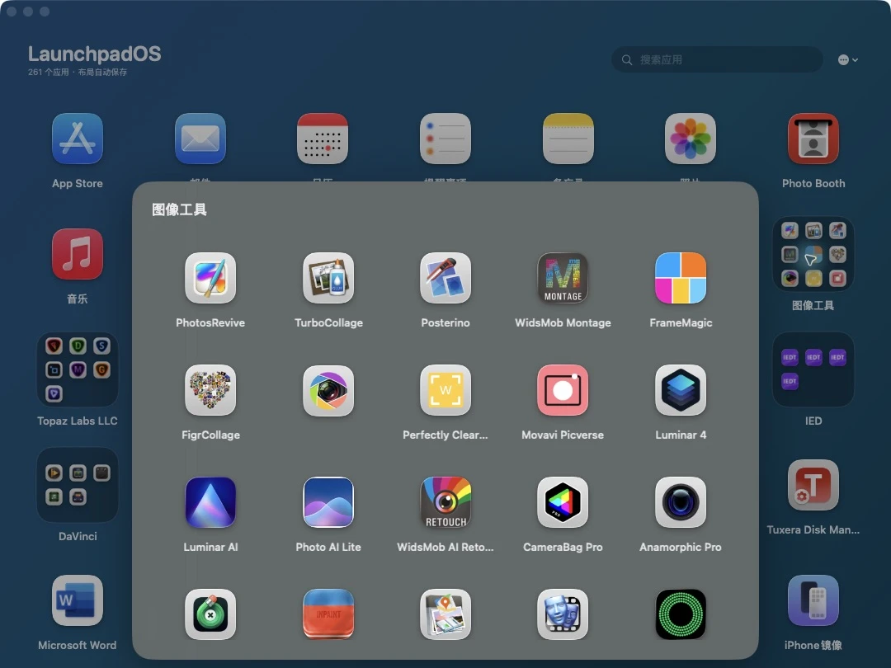
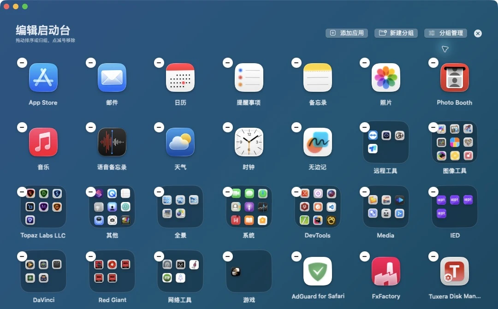
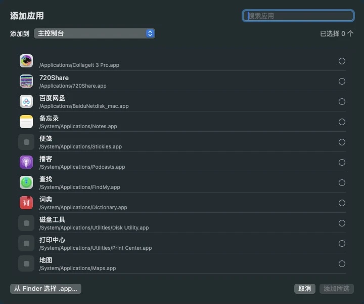
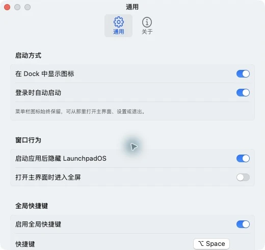

<p align="center">
  
</p>

<h1 align="center">LaunchpadOS</h1>

<p align="center">
  把熟悉的应用网格、文件夹分组和快捷启动，带回你的 Mac。
</p>

<p align="center">
  
  
  
  
</p>

<p align="center">
  简体中文 · <a href="README.en.md">English</a> ·
  <a href="https://github.com/JackerKun/LaunchpadOS/releases">下载安装</a> ·
  <a href="#界面导览">界面导览</a> ·
  <a href="#快速使用">快速使用</a> ·
  <a href="#快捷键">快捷键</a> ·
  <a href="docs/BUILDING.md">构建与发布</a>
</p>



_截图来自本机已安装的 LaunchpadOS 0.4.7（Build 13），为真实界面截图，按内容裁切；应用、图标和分组因每台 Mac 而异。截图中 261 个应用是当前机器的扫描数量，不是性能验收规模。见[截图说明](docs/screenshots/README.md)。_

---

## 为什么是 LaunchpadOS？

如果你习惯把应用放进文件夹、按自己的顺序排列，再用一个快捷键呼出网格，LaunchpadOS 提供这样的独立工作区。它使用 SwiftUI 和 AppKit 原生开发，布局保存于自己的本地目录，不修改 Dock 或系统 Launchpad 数据库。它不是 Apple 官方应用，也不是系统补丁。

## 功能亮点

| | 功能 | 说明 |
| --- | --- | --- |
| 🚀 | 原生应用启动 | 扫描系统与用户应用目录，支持搜索和一键启动 |
| 📁 | 文件夹分组 | 新建、重命名、删除分组，并可调整分组内应用顺序 |
| ✨ | 编辑模式 | 长按进入编辑，可移动、移除、归组和恢复应用 |
| ➕ | 手动添加应用 | 从已扫描列表或 Finder 选择 `.app`，添加到主界面或指定分组 |
| ⌨️ | 全局快捷键 | 默认 `⌥ Space`，可在设置中录制任意新组合键 |
| 🖥️ | 多显示器支持 | 快捷键呼出时跟随鼠标所在显示器并自动居中 |
| 🧭 | 旧布局导入 | 可导入 Launchpal 保存的旧 Launchpad 页面与文件夹 |
| ⚡️ | 缓存与按需加载 | 缓存应用目录与图标，拖动结束后统一保存；未做大规模性能基准承诺 |
| ◻️ | 单窗口体验 | 主界面只保留一个实例，重复呼出不会产生多个窗口 |
| 🔒 | 安全克制 | 不使用私有 API，不修改 Dock 或 macOS 系统数据库 |

## 安装

从 [GitHub Releases](https://github.com/JackerKun/LaunchpadOS/releases) 下载已发布的版本，要求 **macOS 14+**：

| 你的 Mac | 下载文件名中的架构 |
| --- | --- |
| M 系列芯片（Apple Silicon） | `arm64` |
| Intel 处理器 | `x86_64` |
| 需要在两种 Mac 间分发同一份应用 | `universal`（通用版） |

每种架构提供 DMG 和 `.app.zip`；不提供 Windows / Linux 版本。发布页同时提供 `SHA256SUMS.txt`，用于核对下载完整性。

1. 打开下载的 `LaunchpadOS_<版本>_<架构>.dmg`。
2. 将 **LaunchpadOS** 拖到 **Applications**。
3. 从“应用程序”目录启动 LaunchpadOS。

> [!NOTE]
> 当前本地构建使用临时签名，尚未进行 Apple Developer ID 公证。macOS 可能提示无法验证开发者。仅在确认文件来源后，按系统提供的“打开”或“隐私与安全性”入口处理；校验码只能验证下载文件一致性，不能替代开发者签名。

## 界面导览

### 搜索：不必记住应用放在哪个分组

输入应用名称或 Bundle ID，主网格立即过滤；搜索结果中也能找到文件夹里的应用。回车先把焦点移到结果，方向键 / Tab 选择后再回车打开。



### 文件夹：把同一类工具放在一起

点击文件夹，在当前窗口内查看组内应用；文件夹名称可以直接编辑。主网格与文件夹中的顺序均可整理。



### 编辑：排序、归组与移除入口集中显示

长按图标，或从右上角菜单选择“编辑启动台”。拖动调整顺序，把应用拖到另一个应用上建立分组，拖到已有文件夹中继续归组。减号只从当前布局移除，不卸载 `.app`；删除分组会把组内应用放回主界面。



### 添加应用：扫描列表与 Finder 两种来源

从“添加应用”面板中多选，并选择主控制台或已有分组；也可以用 Finder 指定其他位置的 `.app`。确认前可以取消，不会移动原应用包。



### 设置：按照自己的启动习惯调整

`⌘ ,` 打开设置，配置 Dock 图标、登录启动、启动后隐藏、全屏与全局快捷键。设置窗口可滚动；截图展示的是当前机器的选择，不代表默认值。

<p align="center"></p>

## 快速使用

### 主界面

- 点击应用图标：启动应用。
- 点击文件夹：在主窗口内部打开分组。
- 搜索框：按名称或 Bundle ID 搜索应用。
- 搜索后按回车：焦点跳到第一个结果，可用方向键或 Tab 选择，回车启动。
- 按 `Esc`：隐藏主窗口。
- 再次按全局快捷键：显示或隐藏 LaunchpadOS。

### 编辑与分组

- 长按应用或文件夹：进入编辑模式。
- 拖动图标：调整主界面顺序。
- 将一个应用拖到另一个应用上：创建新分组。
- 将应用拖到文件夹：加入该分组。
- 点击右上角关闭图标或按 `Esc`：退出编辑模式。
- 打开“分组管理”：重命名、删除分组或恢复已移除应用。

### 添加应用

在右上角菜单或编辑模式中选择“添加应用”：

1. 从扫描结果中多选应用，或点击“从 Finder 选择 `.app`”。
2. 选择目标位置：主控制台或已有分组。
3. 点击“添加所选”。

支持 `/Applications`、`/System/Applications`、`~/Applications`，也支持从其他位置手动选择应用文件包。

## 快捷键

| 快捷键 | 作用 |
| --- | --- |
| `⌥ Space` | 默认全局显示/隐藏快捷键 |
| `Esc` | 关闭分组、退出编辑或隐藏主窗口 |
| `⌘ ⇧ R` | 重新扫描应用 |
| `⌘ ,` | 打开设置 |
| `↑` `↓` `←` `→` | 在应用网格中移动焦点 |
| `Tab` / `⇧ Tab` | 向前或向后选择图标 |
| `Return` | 打开当前聚焦的应用或文件夹 |
| `Delete` | 从图标返回搜索框，并删除搜索词的最后一个字符 |

全局快捷键可在“设置 → 通用 → 全局快捷键”中重新录制。发生按键冲突时，LaunchpadOS 会保留原来的有效快捷键。

## 设置

- 登录时自动启动。
- 显示或隐藏 Dock 图标。
- 启动应用后自动隐藏 LaunchpadOS。
- 打开主界面时自动进入全屏。
- 启用、关闭或修改全局快捷键。

菜单栏图标始终提供打开主界面、刷新应用、进入设置和退出程序的入口。

## 数据与兼容性

LaunchpadOS 的布局保存在：

```text
~/Library/Application Support/LaunchpadOS/layout.json
```

应用目录缓存保存在：

```text
~/Library/Application Support/LaunchpadOS/catalog.json
```

旧布局导入读取的是 **Launchpal 已保存的 JSON**，不会直接恢复任意 macOS 系统数据库。默认路径为：

```text
~/Library/Application Support/Launchpal/launchpad_data.json
```

布局和目录缓存使用原子写入。备份前退出应用，至少复制 `layout.json`；`catalog.json` 是应用路径缓存，可通过重新扫描更新。通用设置另外保存在 macOS 的应用偏好设置中，不包含在这两个 JSON 内。

重新导入旧布局会替换当前布局，请先备份当前 `layout.json`。移除图标不等于卸载应用；卸载 LaunchpadOS 也不会卸载其展示的其他应用。

## 从源码构建

### 环境要求

- macOS 14 或更高版本
- Apple Command Line Tools，或完整 Xcode
- Swift 6

### 构建应用、DMG 与 ZIP

```bash
# 默认构建当前机器架构，也可以显式选择
zsh scripts/build-app.sh arm64
zsh scripts/build-app.sh x86_64
zsh scripts/build-app.sh universal
```

脚本使用当前 Apple 工具链对应的 macOS SDK；也可通过 `SDKROOT` 显式指定兼容 SDK。输出包括 `dist/LaunchpadOS.app`、带版本和架构名称的 DMG / `.app.zip` / `.sha256`。构建会核对 Mach-O 架构、验证 ad-hoc 签名及磁盘映像，不会启动新构建或更改已安装应用。

```bash
open ./dist/LaunchpadOS.app   # 手动运行本地构建
swift run LaunchpadOS       # 源码开发运行
```

### GitHub 自动构建

推送 `v0.4.7` 这样的版本标签，工作流会构建 **arm64、x86_64、universal**，检查架构、签名与安装包，然后统一发布 Releases。全部成功之前不会公开不完整版本。手动运行分支只生成 Actions artifacts。

版本标签必须与 `Resources/Info.plist` 一致。后续发布、失败重跑和下载校验详见[构建与发布指南](docs/BUILDING.md)。

## 项目结构

```text
LaunchpadOS/
├── Package.swift
├── Resources/             # Info.plist、应用图标
├── Sources/LaunchpadOS/   # SwiftUI 与 AppKit 源码
├── scripts/              # 构建脚本、发布校验及测试
├── docs/screenshots/     # 真实截图及来源
├── .github/workflows/    # 三种 macOS 架构构建与 Release
└── dist/                 # 本地构建产物（不提交 Git）
```

## 当前版本

**LaunchpadOS 0.4.7 · Build 13**

主要能力包括单窗口启动台、文件夹分组、编辑模式、应用手动导入、自定义全局快捷键、多显示器居中和旧布局恢复。
